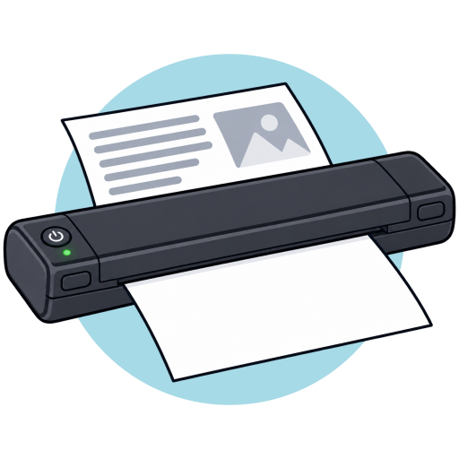

```{raw} html
<div class="hero">
  
</div>
```

# phomemo-driver

**Print to a Phomemo thermal printer like to any other printer.**

The Phomemo M08F is an A4 thermal printer that only speaks Bluetooth LE, with
a protocol of its own on top. The manufacturer means it to be used through
their phone app only: an app that is mostly bloat, asks for more trust than it
deserves, and even uploads your documents to the manufacturer's servers before
it prints them.

phomemo-driver turns the printer into an ordinary IPP printer instead. Your
desktop, your phone and every other IPP client print to it like to any network
printer, and your documents stay on your network. The Python library underneath
also lets you control the printer from your own code.

## Quickstart

On Fedora, with the printer switched on, in range and not connected to a phone:

```bash
sudo dnf copr enable passionatebytes/phomemo-driver
sudo dnf install phomemo-driver     # installs and starts both services
sudo phomemo-printer-app autoadd    # registers every printer in range
```

The printer now shows up in your applications' print dialogs. The details,
other ways to install (Debian and Ubuntu packages, source) and the optional
permanent CUPS queue are in [Installation](installation.md) and
[First steps](first-steps.md).

## Where to start

- **You want to print from your computer.** Follow [Installation](installation.md),
  then [First steps](first-steps.md): install, register the printer, print a
  page. That's it.
- **You want to print from Python.** The [library](library.md) scans for
  printers, prints images and bitmaps and reports the printer's sensors as
  events.
- **You want to know how it works, or contribute.** The [driver stack](driver-stack.md)
  explains the parts, the [protocol reference](m08f-protocol-reference.md)
  documents what is known about the M08F, and [Contributing](contributing.md)
  shows how to get started. New [printer models](models.md) are especially
  welcome.

```{toctree}
:caption: Get started
:hidden:

installation
first-steps
```

```{toctree}
:caption: Using it
:hidden:

everyday-use
configuration
command-line
troubleshooting
```

```{toctree}
:caption: Python library
:hidden:

library
api
```

```{toctree}
:caption: Under the hood
:hidden:

driver-stack
print-flow
models
m08f-protocol-reference
glossary
```

```{toctree}
:caption: Project
:hidden:

contributing
```
